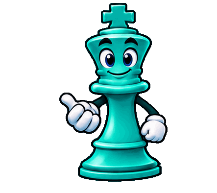

<h1 align="center">
  <b>《~~WELCOME TO MY PROFILE~~》</b>
</h1>

 
 
 
 
 

<br/>


<h1 align="center">

 [](https://git.io/typing-svg)

</h1>

<br/>

## Join my Discord Server [@LegendWorks](https://discord.gg/8vtkfhBVSg)


<div align="center">


</div>

---


# 💻 Tech Stack

<div align="center">


<br/>


</div>

---


# 📊 Profile Analytics

<div align="center">


</div>

---


# 🏆 GitHub Trophies


# 👨‍💻 About Me

<table>
  <tr>
    <td width="560" valign="top">

```yaml
Name: LegedsDaD
Role: Full Stack Python Developer

Focus:
  - AI Agents & Intelligent Automation
  - Custom Developer Tools & CLI Utilities
  - High-Performance Backend Applications

Currently Learning:
  - Advanced LLM Integrations & Agent Workflows
  - Modern UI/UX & Local AI Workspaces

Goals:
  - Build innovative, open-source developer tools
  - Architect powerful, privacy-first local AI systems
  - Contribute meaningfully to the Python & AI community
```

  </td>
    <td width="340" align="center" valign="middle">
      
    </td>
  </tr>
</table>

---


# 🚀 Featured Projects

<div align="center">

| Project | Description |
|---|---|
| 🎮 **[Simple Game Engine](https://github.com/LegedsDaD/Simple-The_Game_Engine)** | Lightweight Python-based game engine |
| 🤖 **[Easier Bot](https://github.com/LegedsDaD/EasierBot)** | Automation bot for repetitive tasks |
| 📐 **[Calculus](https://github.com/LegedsDaD/CalCulus)** | Mathematical tools & calculations |
| 🌌 **[Three Dimensions](https://github.com/LegedsDaD/ThreeDimensions)** | 3D visualization experiments |
| 🎨 **[True Graphics](https://github.com/LegedsDaD/TrueGraphics)** | Graphics rendering for Windows |

</div>

---


# 🧠 Currently Building

<div align="center">

  
</div>

- 🤖 Building **AgentDesk** – Local AI Workspace for Developers  
- ⚡ Creating **high-performance Python tools**  
- 🧪 Experimenting with **AI agents & LLM automation**  
- 🛠️ Improving **developer-friendly GUIs**  
- 🚀 Exploring **real-world AI integrations**

---


# 📈 GitHub Stats
<div align="center">


</div>


# 🐍 Contributions

<div align="center">


<br/>


</div>

---

# 🌟 The amazing people loving my work

<!-- FOLLOWERS:START -->

    <div align="center">
        <p><b>30 amazing people are following me!</b></p>
        <table>
            <tr>
            <td align="center" width="16.66%">
                <a href="https://github.com/souzaonofre">
                    
                    <br />
                    <sub><b>@souzaonofre</b></sub>
                </a>
            </td>
            
            <td align="center" width="16.66%">
                <a href="https://github.com/AppServiceProvider">
                    
                    <br />
                    <sub><b>@AppServiceProvider</b></sub>
                </a>
            </td>
            
            <td align="center" width="16.66%">
                <a href="https://github.com/samertall">
                    
                    <br />
                    <sub><b>@samertall</b></sub>
                </a>
            </td>
            
            <td align="center" width="16.66%">
                <a href="https://github.com/nithin42">
                    
                    <br />
                    <sub><b>@nithin42</b></sub>
                </a>
            </td>
            
            <td align="center" width="16.66%">
                <a href="https://github.com/AmitManna99">
                    
                    <br />
                    <sub><b>@AmitManna99</b></sub>
                </a>
            </td>
            
            <td align="center" width="16.66%">
                <a href="https://github.com/IsaacAlves7">
                    
                    <br />
                    <sub><b>@IsaacAlves7</b></sub>
                </a>
            </td>
            </tr><tr>
            <td align="center" width="16.66%">
                <a href="https://github.com/Kukzze">
                    
                    <br />
                    <sub><b>@Kukzze</b></sub>
                </a>
            </td>
            
            <td align="center" width="16.66%">
                <a href="https://github.com/amasen02">
                    
                    <br />
                    <sub><b>@amasen02</b></sub>
                </a>
            </td>
            
            <td align="center" width="16.66%">
                <a href="https://github.com/Scottcjn">
                    
                    <br />
                    <sub><b>@Scottcjn</b></sub>
                </a>
            </td>
            
            <td align="center" width="16.66%">
                <a href="https://github.com/Codehide0989">
                    
                    <br />
                    <sub><b>@Codehide0989</b></sub>
                </a>
            </td>
            
            <td align="center" width="16.66%">
                <a href="https://github.com/AhmedAlvi29">
                    
                    <br />
                    <sub><b>@AhmedAlvi29</b></sub>
                </a>
            </td>
            
            <td align="center" width="16.66%">
                <a href="https://github.com/fmoorenoo">
                    
                    <br />
                    <sub><b>@fmoorenoo</b></sub>
                </a>
            </td>
            </tr><tr>
            <td align="center" width="16.66%">
                <a href="https://github.com/abdullokhonz">
                    
                    <br />
                    <sub><b>@abdullokhonz</b></sub>
                </a>
            </td>
            
            <td align="center" width="16.66%">
                <a href="https://github.com/Code2With-Pratik">
                    
                    <br />
                    <sub><b>@Code2With-Pratik</b></sub>
                </a>
            </td>
            
            <td align="center" width="16.66%">
                <a href="https://github.com/gam3r999">
                    
                    <br />
                    <sub><b>@gam3r999</b></sub>
                </a>
            </td>
            
            <td align="center" width="16.66%">
                <a href="https://github.com/shaaravraghu">
                    
                    <br />
                    <sub><b>@shaaravraghu</b></sub>
                </a>
            </td>
            
            <td align="center" width="16.66%">
                <a href="https://github.com/jewelshirat">
                    
                    <br />
                    <sub><b>@jewelshirat</b></sub>
                </a>
            </td>
            
            <td align="center" width="16.66%">
                <a href="https://github.com/wesalee83-dev">
                    
                    <br />
                    <sub><b>@wesalee83-dev</b></sub>
                </a>
            </td>
            </tr><tr>
            <td align="center" width="16.66%">
                <a href="https://github.com/axelyahirgonzalesmartinez541-gif">
                    
                    <br />
                    <sub><b>@axelyahirgonzalesmartinez541-gif</b></sub>
                </a>
            </td>
            
            <td align="center" width="16.66%">
                <a href="https://github.com/binitkafle">
                    
                    <br />
                    <sub><b>@binitkafle</b></sub>
                </a>
            </td>
            
            <td align="center" width="16.66%">
                <a href="https://github.com/pandasipra76-cell">
                    
                    <br />
                    <sub><b>@pandasipra76-cell</b></sub>
                </a>
            </td>
            
            <td align="center" width="16.66%">
                <a href="https://github.com/ProfessorGhoshal">
                    
                    <br />
                    <sub><b>@ProfessorGhoshal</b></sub>
                </a>
            </td>
            
            <td align="center" width="16.66%">
                <a href="https://github.com/aryan8-git">
                    
                    <br />
                    <sub><b>@aryan8-git</b></sub>
                </a>
            </td>
            
            <td align="center" width="16.66%">
                <a href="https://github.com/EasierBot">
                    
                    <br />
                    <sub><b>@EasierBot</b></sub>
                </a>
            </td>
            </tr><tr>
            <td align="center" width="16.66%">
                <a href="https://github.com/codeby-Vishwajeet">
                    
                    <br />
                    <sub><b>@codeby-Vishwajeet</b></sub>
                </a>
            </td>
            
            <td align="center" width="16.66%">
                <a href="https://github.com/data-probe-1">
                    
                    <br />
                    <sub><b>@data-probe-1</b></sub>
                </a>
            </td>
            
            <td align="center" width="16.66%">
                <a href="https://github.com/gotkunal15">
                    
                    <br />
                    <sub><b>@gotkunal15</b></sub>
                </a>
            </td>
            
            <td align="center" width="16.66%">
                <a href="https://github.com/yueffhjg">
                    
                    <br />
                    <sub><b>@yueffhjg</b></sub>
                </a>
            </td>
            
            <td align="center" width="16.66%">
                <a href="https://github.com/sarbatra3">
                    
                    <br />
                    <sub><b>@sarbatra3</b></sub>
                </a>
            </td>
            
            <td align="center" width="16.66%">
                <a href="https://github.com/bklll98">
                    
                    <br />
                    <sub><b>@bklll98</b></sub>
                </a>
            </td>
            </tr>
        </table>
    </div>
    
<!-- FOLLOWERS:END -->


# 🌐 Connect With Me

<div align="center">

[](https://github.com/LegedsDaD)

</div>

---


# ✍️ Random Dev Quote

<div align="center">


</div>

---


